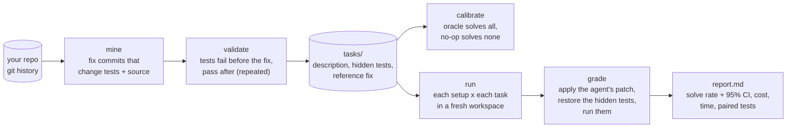

# hometurf

**A private SWE-bench built from your own repository's git history.** hometurf finds the commits where someone fixed a bug and added a test for it, rebuilds the code as it was before each fix, and keeps a task only if its tests fail before the fix and pass after it. Then it runs your coding-agent setups on those tasks and ranks them by how many they solve, what they cost, and how long they take, with confidence intervals so you can tell a real difference from noise.

[](https://github.com/trailofblocks/hometurf/actions/workflows/ci.yml)
[](LICENSE)

A public benchmark tells you how an agent does on other people's code, and its tasks may well have been in the model's training data. What you want to know is narrower: on *your* code, does the new model beat the old one, is the rewritten `CLAUDE.md` an improvement, and is the extra cost worth it? Your own history already holds the answer key. Every bug-fix commit with a regression test is a task with a known, checkable solution, and if the repository is private, no model has trained on it.

A *setup* is whatever you want to compare: a model, an `AGENTS.md` or `CLAUDE.md` variant, a set of skills or tools, a different agent CLI. hometurf runs each setup on the same tasks, grades every attempt with the repository's own tests, and reports the result.

```text
$ hometurf run --name demo --jobs 4
...
setup            solved  95% CI   partial  cost/attempt  median time
oracle           32/32   89–100%  100%     n/a           0.0 s
gold-first-hunk  17/32   36–69%   54.7%    n/a           0.0 s
noop             0/32    0–11%    0%       n/a           0.0 s
oracle vs gold-first-hunk: only oracle solved 15, only gold-first-hunk solved 0, McNemar p < 0.001 (oracle solves more)
oracle vs noop: only oracle solved 32, only noop solved 0, McNemar p < 0.001 (oracle solves more)
gold-first-hunk vs noop: only gold-first-hunk solved 17, only noop solved 0, McNemar p < 0.001 (gold-first-hunk solves more)
```

That is the leaderboard from the [sqlparse demo](#evaluation-sqlparse) below: 32 tasks mined from nearly four years of a real Python library. The three setups are calibration agents, not models: `oracle` applies the real fix, `noop` changes nothing, and `gold-first-hunk` applies only the first hunk of the real fix. No model has been run yet (see [What hasn't been verified](#what-hasnt-been-verified)).

## How it works



1. **Mine.** `hometurf mine` walks first-parent history, so a squash-merged PR or a merge commit is one candidate. It sorts each change's files into test files and source files with globs you control. A candidate needs a new or changed test and a source change. Commits that touch dependency manifests or lockfiles are skipped (the environment would need rebuilding), as are oversized fixes and, by default, commits whose message doesn't read like a fix. Docs and changelog edits are left out of the reference fix. Every skip is counted, with its reason.
2. **Validate.** `hometurf validate` checks out the parent commit, adds the fix's test files, and runs them: these are the runs *before* the fix. Then it does the same with the fix applied: the runs *after*. A test that fails (or doesn't exist yet) in every run before and passes in every run after is a **fail-to-pass** test. One that passes everywhere is a **pass-to-pass** test, there to catch regressions. A test whose result changes between two runs of the same code is dropped as flaky. A candidate with no fail-to-pass test is rejected, and so is one whose test command crashes or times out: hometurf would rather lose a task than guess.
3. **Calibrate.** `hometurf calibrate` runs two built-in agents through the full pipeline: the oracle, which applies the real fix, must solve every task, and the no-op agent must solve none. A task that fails either check is flagged before you spend money on it.
4. **Run.** `hometurf run` gives each setup each task in a fresh workspace and grades the attempt (details below).
5. **Report.** `report.md` has the leaderboard, paired comparisons between setups, a task-by-setup grid, how the tasks were mined, and every attempt worth a second look.

## What keeps a solve honest

The agent is graded by tests that aren't in its workspace (unless you pass `--reveal-tests`), on a patch hometurf builds itself.

| What could go wrong | What hometurf does | Tested in |
|---|---|---|
| The agent runs `git log` and reads the fix from a later commit | The workspace is a brand-new repository with one commit holding the pre-fix files. It has no history and no remote, and the original commits aren't in it. | `tests/pipeline.test.ts` ("has one commit, no remotes, no later history") |
| The agent edits the tests until they pass | Before grading, every change to a test-side file (`tests.files` and `tests.protect`, such as `conftest.py` or `pytest.ini`) is discarded, and the fix's own test files are written in. The report lists each attempt that tried. | the `tamper` agent in `tests/pipeline.test.ts` |
| The agent rewrites its own git history to hide or fake changes | The patch is taken from a separate git directory kept outside the workspace, not from the workspace's `.git`. | "collects the agent's change and discards edits to test files and the agent's own git history" |
| Flaky tests make a fix look good or bad by chance | Validation runs the tests twice before the fix and three times after; any test whose result changes is left out of the task. | the fixture's `flaky` test |
| A task's tests can't tell a fix from no fix | `calibrate` fails if the no-op agent solves a task or the oracle doesn't. | `tests/cli.test.ts` ("calibrate fails when a task's tests can't detect the bug") |
| An agent hangs, or leaves processes running | Every agent, setup, and test command has a timeout. On a timeout the whole process tree is killed (`taskkill /T` on Windows, the process group elsewhere), and the attempt is graded on whatever it changed. Outside Windows, background processes are also killed when the command exits. | the `hang` agent, `tests/proc.test.ts` |
| Ten tasks make a 10-point gap look decisive | Solve rates come with Wilson 95% intervals over tasks, and setups are compared with an exact McNemar test on the tasks both ran. The report says "can't tell apart" when the data can't. | `tests/units.test.ts` |
| The agent goes looking on disk and copies the reference fix from the benchmark folder | **Not prevented.** Agents run with your permissions (see [Limitations](#limitations)). Run untrusted agents in a container or VM. | — |

## Quick start

hometurf needs Node 22.12 or later and git. Your repository's test runner must be able to write a JUnit XML report, which pytest, Node's test runner, Jest (with jest-junit), Vitest, Go (with gotestsum), and most others can.

```bash
git clone https://github.com/trailofblocks/hometurf && cd hometurf
npm ci && npm run build && npm link        # puts `hometurf` on your PATH

hometurf init ../your-repo --bench ../your-bench   # detects pytest or node:test; edit the config it writes
cd ../your-bench
hometurf mine --since 2024-01-01
hometurf validate --jobs 4
hometurf calibrate --jobs 4
hometurf run --jobs 2                              # every setup in hometurf.json
```

The benchmark directory holds everything hometurf writes: `hometurf.json`, `candidates.jsonl`, `rejected.jsonl`, one folder per task under `tasks/`, and one folder per run under `runs/`. Nothing is written to your repository.

Each task folder has `task.json` (commits, hidden tests, validation runs), `gold.patch` (the reference fix), and `description.md`, the text the agent is given. The description starts as the commit message with trailers removed. Commit messages are often terse, and sometimes they give the fix away, so read them and edit any that need it: hometurf reads `description.md` fresh on every run, and `hometurf tasks` marks descriptions shorter than six words.

### Adding agent setups

A setup with a `command` runs that command through the shell in the task's workspace. The prompt arrives on stdin and in the file named by `$HOMETURF_PROMPT_FILE`. hometurf also sets `$HOMETURF_TASK_ID` and `$HOMETURF_WORKSPACE`.

```json
{
  "setups": [
    { "name": "oracle", "builtin": "oracle" },
    { "name": "noop", "builtin": "noop" },
    {
      "name": "opus-repo-claude-md",
      "label": "claude-opus-5-5",
      "command": "claude -p --model claude-opus-5-5 --output-format json --permission-mode acceptEdits --allowedTools \"Bash(python -m pytest:*)\" --max-budget-usd 3",
      "usage": "claude-code"
    },
    {
      "name": "opus-new-claude-md",
      "label": "claude-opus-5-5",
      "command": "claude -p --model claude-opus-5-5 --output-format json --permission-mode acceptEdits --allowedTools \"Bash(python -m pytest:*)\" --max-budget-usd 3",
      "usage": "claude-code",
      "files": { "CLAUDE.md": "variants/CLAUDE.v2.md", ".claude/skills/sql/SKILL.md": "variants/sql-skill.md" },
      "remove": ["AGENTS.md"]
    }
  ]
}
```

- `files` copies files into the workspace before the agent starts (paths relative to `hometurf.json`), and `remove` deletes paths. Both are committed into the workspace's base commit, so the agent sees a clean `git status`, and neither counts as part of the agent's change.
- `usage: "claude-code"` reads cost, tokens, and turns from Claude Code's `--output-format json` (or `stream-json`) output. The cost is Claude Code's own estimate. Any other agent can write `{"costUsd": 0.12, "inputTokens": 1000, "outputTokens": 200, "turns": 3}` to `$HOMETURF_USAGE_FILE` (the default, `usage: "file"`). Without either, cost shows as "n/a".
- `prompt` points to a template file with `{{description}}` and `{{task}}` placeholders, if you want to compare prompts too.
- `timeoutSec` and `env` set a per-setup timeout and extra environment variables.

> **Not run.** The Claude Code commands above use flags that `claude --help` lists in Claude Code 2.1.330, but they haven't been run through hometurf, because each attempt is a paid model call. Nor has the prompt arriving on stdin been checked with Claude Code. `--allowedTools` uses Claude Code's permission rules. Check all of this against your version before relying on it.

`hometurf run` options:

| Option | Effect |
|---|---|
| `--setups a,b` | Only these setups. `oracle`, `noop`, and `gold-first-hunk` work without being configured. |
| `--tasks id,id` / `--limit n` | Only these tasks, or the oldest n. |
| `--repeat k` | k attempts per task and setup. The report adds "solved in any of k" and "solved in all k". |
| `--jobs n` | Attempts in parallel. |
| `--max-cost usd` | Stop starting attempts once the reported cost reaches this. Tasks run in task-major order, so when it stops, every setup has been tried on the same tasks, give or take the attempts still in flight with `--jobs`. |
| `--name n` / `--resume` | Name the run; continue an interrupted one without redoing finished attempts. |
| `--reveal-tests` | Put the fix's test files in the workspace: a test-driven task instead of a bug report. |
| `--keep` | Keep the temporary workspaces for debugging. |

`hometurf grade --task <id> --patch fix.diff` grades a patch you made some other way, after dropping any changes it makes to test files.

### Configuration

`hometurf init` writes a starting `hometurf.json` from a preset (`python-pytest` or `node-test`). The fields:

| Field | Meaning |
|---|---|
| `repo`, `ref`, `name` | The repository (relative to `hometurf.json`), the ref to mine from, and the prefix for task ids. |
| `setup` | Shell command run in every fresh checkout before tests or an agent run, such as `npm ci` or `pip install -e .`. |
| `tests.command` | Must write a JUnit report to `{junit}`. `{files}` becomes the test files the fix changed. |
| `tests.files` | Globs for test files: the hidden tests come from here, and agent edits to them are discarded. |
| `tests.run` | Which of those to pass as `{files}`. Defaults to `tests.files`. |
| `tests.protect` | More paths the agent may not change, such as test configuration. |
| `mine.since`, `mine.match`, `mine.all` | Date cut-off; the regex a commit message must match to count as a fix; or `all` to take any commit with tests. |
| `mine.env`, `mine.ignore` | Commits touching `env` paths are skipped. `ignore` paths (docs, changelogs) are left out of the reference fix. |
| `mine.maxSourceFiles`, `mine.maxSourceLines` | Size limits for the reference fix. |
| `validate.beforeRuns`, `validate.afterRuns` | How many times to run the tests before and after the fix (default 2 and 3). |
| `scratch` | Extra ignore patterns for files never counted as part of an agent's change (bytecode, caches). |

Globs: `*` stays within a path segment, `**` crosses them, `{a,b}` is either, and a pattern without a `/` matches the file name at any depth (`test_*.py`).

## Evaluation: sqlparse

[sqlparse](https://github.com/andialbrecht/sqlparse) is a SQL parser for Python with about a thousand first-parent commits, a pytest suite, and no runtime dependencies. Its fix commits usually add a regression test, which is the shape hometurf looks for. [`examples/sqlparse/run-demo.mjs`](examples/sqlparse/run-demo.mjs) clones it at a pinned commit (`09dbe1e`, 1 November 2026) and runs the whole pipeline with [`examples/sqlparse/hometurf.json`](examples/sqlparse/hometurf.json).

sqlparse is public, so models have probably seen these commits. The demo shows that the pipeline works on a real repository. It says nothing about how good any model is.

**Mining**, over commits since 1 January 2023:

| Step | Commits |
|---|---|
| First-parent commits scanned | 183 |
| Skipped: no test file added or changed | 124 |
| Skipped: message doesn't look like a fix | 15 |
| Skipped: no source file changed | 10 |
| Candidates | 34 |
| Rejected: no test fails before the fix and passes after it | 1 |
| Rejected: tests ran past the 120 s limit | 1 |
| **Tasks** | **32** |

The timed-out candidate (`40ed3aa`, "Add hard limits for grouping to prevent DoS attacks") is a real fix. Its new tests assert that parsing large inputs takes under 10 seconds. Before the fix, that test file took 273 s to run on the test laptop, in an earlier run with the default 600 s limit. With the limit at 120 s, hometurf can't tell which tests failed, so it rejects the candidate rather than guess.

The fix filter is deliberately loose (an issue number such as `#537` counts), so a few tasks are features, such as "Add pre-commit hook support (fixes #537)". Their tests still fail before the change and pass after it. Tasks have 1 to 9 fail-to-pass tests (17 of the 32 have exactly one) and 2 to 157 pass-to-pass tests. One description was flagged as thin: "Fix Function.get_parameters(), add Funtion.get_window()".

**Calibration and a baseline**, on Windows 11 with Node 25, Python 3.12, and pytest 9.1.1:

| Setup | What it does | Solved | 95% CI |
|---|---|---|---|
| `oracle` | Applies the real fix | 32/32 | 89–100% |
| `gold-first-hunk` | Applies only the first hunk of the real fix | 17/32 | 36–69% |
| `noop` | Changes nothing | 0/32 | 0–11% |

- **oracle 32/32:** every task can be solved through the full pipeline: workspace, patch collection, restoring the hidden tests, grading.
- **noop 0/32:** every task's hidden tests detect the bug.
- **gold-first-hunk 17/32:** on 15 tasks, the first hunk of the fix doesn't pass on its own. The difference from the oracle is significant (McNemar p < 0.001). This roughly measures how spread out the fixes are; it isn't an agent.
- **Time:** the whole demo (validation, calibration, and 96 graded attempts) took 8 minutes on a laptop with `--jobs 4`. Two of those minutes were the candidate that timed out.

[`.github/workflows/ci.yml`](.github/workflows/ci.yml) runs the same script on Ubuntu and Windows, and fails if calibration fails. It hasn't run yet, because the repository isn't pushed.

## What hasn't been verified

- **No model has been run through hometurf.** Every number in this README comes from scripted agents. The first real comparison costs money, so it waits for an API budget.
- **The Claude Code setup** in the example above hasn't been run (see the note there).
- **Linux, end to end.** Typecheck, build, and the full test suite pass on Ubuntu (WSL, Node 24.22.3, git 2.34). The sqlparse demo has only run on Windows; on Linux it will first run in CI.
- **macOS** hasn't been tried.
- **Other test runners.** pytest and Node's test runner are exercised. Jest, Vitest, Go, and others only need to write JUnit XML, but none has been run.
- **Large repositories.** The fixture has 12 commits and sqlparse about a thousand. A monorepo with a slow setup step will be slow: each attempt and each validation run starts from a fresh checkout.

## Limitations

- **Not a sandbox.** Agents run on your machine with your permissions. hometurf keeps the answer out of the workspace and grades from its own copy, but an agent that goes looking can read other folders, including the benchmark directory with the reference fixes. Run untrusted agents in a container or VM.
- **Descriptions come from commit messages.** They can be too terse to act on, or describe the fix outright. Read and edit `description.md` before comparing setups.
- **The tests define "solved".** A fix that passes the hidden tests by special-casing them counts, and a correct fix that the tests don't recognize doesn't. Read the patches of surprising results; each attempt's `patch.diff` is in the run folder.
- **Environment drift.** Old commits run with today's interpreter and packages. Commits that change dependencies are skipped, and validation rejects tasks that no longer run, but a task validated on one machine can behave differently on another. Validate on the machine you benchmark on.
- **Tasks are validated per platform.** A task validated on Windows may not hold on Linux, and the other way round. `task.json` records where it was validated.
- **On Windows, a process an agent leaves running after it exits** isn't stopped (Windows has no process groups to kill). On a timeout the whole tree is killed.
- **Submodules, Git LFS files, and binary fixes** are not supported. Fixes that change binary files are skipped.

## Roadmap

- Run inside a container per attempt (Docker or Podman), for untrusted agents and reproducible environments.
- Pull issue and PR text from GitHub or GitLab when a commit references one, for richer descriptions than commit messages.
- An HTML report with per-attempt patches and transcripts.
- Cost-aware ranking: a Pareto view of solve rate against cost.

## Development

```bash
npm ci
npm run typecheck
npm run build
npm test                                   # builds a fixture repo with git and node:test; no network, no API key
node examples/sqlparse/run-demo.mjs ../ht-demo --jobs 4   # needs network, Python, and pytest
```

The tests build a small Node library repository from scratch, with fixed identities and dates, whose history covers each case the miner and validator must handle: a plain fix, a merge commit, a feature, a test-only change, a docs change, a dependency bump, an oversized fix, a fix whose new test already passed, and a fix next to a flaky test. Agents are scripted Node programs in `tests/fixtures/agents/`.

## License

[MIT](LICENSE)
